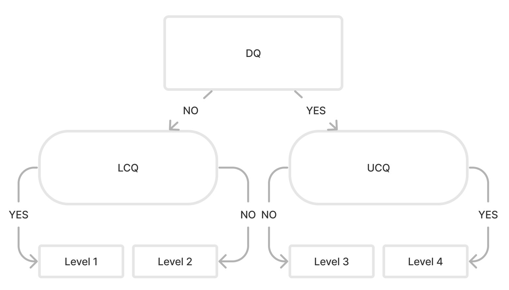
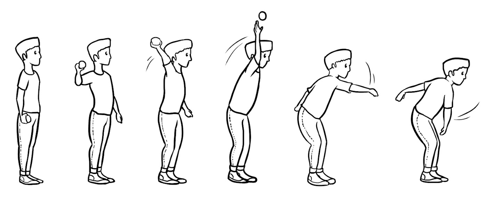
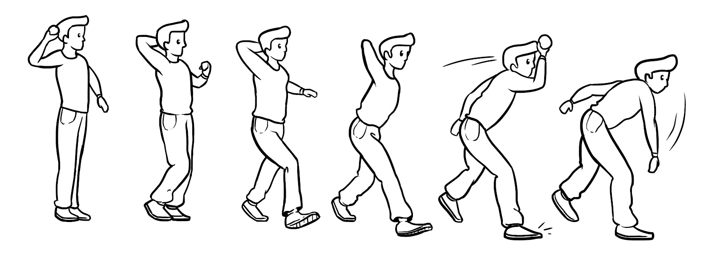
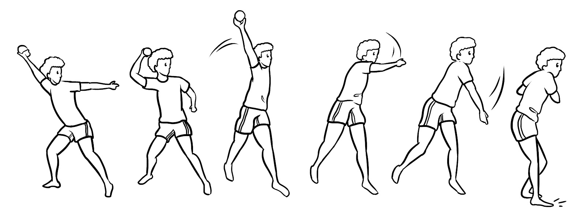
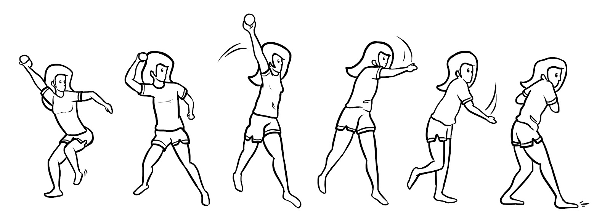

```{=html}
<!-- ============ HERO ============ -->
<section class="fg-hero column-screen" aria-labelledby="hero-title">
  <div class="fg-wrap fg-hero-grid">
    <div class="fg-hero-copy">
      <p class="fg-eyebrow">Movement skills assessment · Ages 5–10</p>
      <h1 id="hero-title">See how well a child moves, in two yes/no questions per skill.</h1>
      <p class="fg-lead">
        <strong>FG-COMPASS</strong> helps teachers, coaches, clinicians and researchers rate how children perform
        10 everyday movement skills, like throwing, kicking and jumping, on a simple <strong>1–4 scale</strong>.
        You watch the child live. No video, no lengthy checklists.
      </p>
      <div class="fg-cta">
        <a class="btn btn-primary btn-lg" href="static/files/fgcompass-decision-trees-v2.2.pdf">
          <i class="bi bi-download" aria-hidden="true"></i> Download the decision trees
        </a>
        <a class="btn btn-outline-secondary btn-lg" href="https://drfurtado.github.io/compass-manual/">
          <i class="bi bi-book" aria-hidden="true"></i> Read the manual
        </a>
      </div>
      <p class="fg-hero-note">Free PDF · Research-validated · Built for schools, clinics and labs</p>
    </div>

    <!-- Interactive demo -->
    <div class="fg-demo" id="fg-demo" aria-live="polite">
      <div class="fg-demo-head">
        <span class="fg-demo-tag">Try it</span>
        <span class="fg-demo-skill"><i class="bi bi-dribbble" aria-hidden="true"></i> Overhand throw</span>
      </div>
      <p class="fg-demo-step" id="fg-demo-step">Question 1 of 2</p>
      <p class="fg-demo-q" id="fg-demo-q">Did the trunk rotate to the side of the throw during preparation?</p>
      <div class="fg-demo-btns" id="fg-demo-btns">
        <button type="button" class="btn fg-yes" data-a="yes">Yes</button>
        <button type="button" class="btn fg-no" data-a="no">No</button>
      </div>
      <div class="fg-demo-result" id="fg-demo-result" hidden>
        <div class="fg-level-badge" id="fg-demo-level">4</div>
        <div>
          <p class="fg-demo-level-name" id="fg-demo-level-name">Level 4 · Proficient</p>
          <p class="fg-demo-level-desc" id="fg-demo-level-desc"></p>
        </div>
      </div>
      <div class="fg-demo-foot">
        <div class="fg-demo-track" aria-hidden="true">
          <span data-l="1">1</span><span data-l="2">2</span><span data-l="3">3</span><span data-l="4">4</span>
        </div>
        <button type="button" class="fg-demo-reset" id="fg-demo-reset" hidden>
          <i class="bi bi-arrow-counterclockwise" aria-hidden="true"></i> Try again
        </button>
      </div>
    </div>
  </div>
</section>

<!-- ============ AT A GLANCE ============ -->
<section class="fg-stats column-screen" aria-label="FG-COMPASS at a glance">
  <div class="fg-wrap fg-stats-grid">
    <div><strong>10</strong><span>movement skills</span></div>
    <div><strong>2</strong><span>subtests: locomotor &amp; object control</span></div>
    <div><strong>5–10</strong><span>years of age</span></div>
    <div><strong>4</strong><span>proficiency levels</span></div>
    <div><strong>Live</strong><span>observation, no video needed</span></div>
  </div>
</section>

<!-- ============ WHY ============ -->
<section class="fg-section column-screen" id="why" aria-labelledby="why-title">
  <div class="fg-wrap fg-two">
    <div>
      <p class="fg-kicker">Why it matters</p>
      <h2 id="why-title">Movement skills are the building blocks of an active, healthy childhood.</h2>
    </div>
    <div class="fg-prose">
      <p>
        Running, jumping, throwing and catching are <em>fundamental movement skills</em>. Children who move well
        tend to be more physically active, and research links these skills to healthier body composition,
        stronger thinking skills such as working memory, and more confident play with peers.
      </p>
      <p>
        Spotting where a child is, and where they are stuck, lets you teach the next step and catch delays early.
        FG-COMPASS makes that check fast enough to do in a regular class or clinic session.
      </p>
    </div>
  </div>
</section>

<!-- ============ HOW IT WORKS ============ -->
<section class="fg-section fg-alt column-screen" id="how-it-works" aria-labelledby="how-title">
  <div class="fg-wrap">
    <p class="fg-kicker">How it works</p>
    <h2 id="how-title">Watch, answer, score. That's it.</h2>
    <ol class="fg-steps">
      <li>
        <span class="fg-step-icon"><i class="bi bi-eye" aria-hidden="true"></i></span>
        <h3>Watch the child perform a skill</h3>
        <p>Observe the skill live, in the gym, playground or clinic. A short protocol covers setup, instructions and trials for each skill.</p>
      </li>
      <li>
        <span class="fg-step-icon"><i class="bi bi-signpost-split" aria-hidden="true"></i></span>
        <h3>Answer two yes/no questions</h3>
        <p>The first question points toward the lower or upper levels. A second question confirms where the child lands.</p>
      </li>
      <li>
        <span class="fg-step-icon"><i class="bi bi-bar-chart-steps" aria-hidden="true"></i></span>
        <h3>Get a level from 1 to 4</h3>
        <p>Record the level for each skill to see a child's profile, track progress or compare before and after a program.</p>
      </li>
    </ol>

    <div class="fg-tree" id="fg-tree" data-cap4="Key feature seen, proficient pattern confirmed: <strong>Level 4, Proficient</strong>" data-cap3="Key feature seen, proficient pattern not confirmed: <strong>Level 3, Developing</strong>" data-cap2="Key feature not seen, early pattern not confirmed: <strong>Level 2, Emerging</strong>" data-cap1="Key feature not seen, early pattern confirmed: <strong>Level 1, Initial</strong>" data-pause="Pause" data-play="Play">
      <div class="fg-tree-head">
        <h3>The decision tree in action</h3>
        <p>Every skill uses the same three-question tree. Each child follows one path: a key question, then one confirming question.</p>
      </div>
      <svg viewBox="0 0 560 330" role="img" aria-label="Animated decision tree showing the four possible paths to levels 1 to 4">
        <g class="e" id="e-q1-l"><path d="M280 76 L130 132"/><text x="185" y="98" class="el">No</text></g>
        <g class="e" id="e-q1-r"><path d="M280 76 L430 132"/><text x="375" y="98" class="el">Yes</text></g>
        <g class="e" id="e-l-1"><path d="M90 200 L65 252"/><text x="58" y="230" class="el">Yes</text></g>
        <g class="e" id="e-l-2"><path d="M170 200 L195 252"/><text x="202" y="230" class="el">No</text></g>
        <g class="e" id="e-r-3"><path d="M390 200 L365 252"/><text x="358" y="230" class="el">No</text></g>
        <g class="e" id="e-r-4"><path d="M470 200 L495 252"/><text x="502" y="230" class="el">Yes</text></g>
        <g class="n" id="n-q1"><rect x="150" y="8" width="260" height="68" rx="14"/><text x="280" y="32" class="k">Question 1</text><text x="280" y="57">Key feature seen?</text></g>
        <g class="n" id="n-l"><rect x="20" y="132" width="220" height="68" rx="34"/><text x="130" y="150" class="k">Question 2</text><text x="130" y="169">Early pattern</text><text x="130" y="192">confirmed?</text></g>
        <g class="n" id="n-r"><rect x="320" y="132" width="220" height="68" rx="34"/><text x="430" y="150" class="k">Question 2</text><text x="430" y="169">Proficient pattern</text><text x="430" y="192">confirmed?</text></g>
        <g class="n lv" id="n-1"><rect x="10" y="252" width="115" height="66" rx="12"/><text x="67" y="281" class="big">Level 1</text><text x="67" y="303" class="s">Initial</text></g>
        <g class="n lv" id="n-2"><rect x="140" y="252" width="115" height="66" rx="12"/><text x="197" y="281" class="big">Level 2</text><text x="197" y="303" class="s">Emerging</text></g>
        <g class="n lv" id="n-3"><rect x="305" y="252" width="115" height="66" rx="12"/><text x="362" y="281" class="big">Level 3</text><text x="362" y="303" class="s">Developing</text></g>
        <g class="n lv" id="n-4"><rect x="435" y="252" width="115" height="66" rx="12"/><text x="492" y="281" class="big">Level 4</text><text x="492" y="303" class="s">Proficient</text></g>
      </svg>
      <div class="fg-tree-foot">
        <p class="fg-tree-cap" id="fg-tree-cap" aria-live="polite">&nbsp;</p>
        <button type="button" class="fg-tree-toggle" id="fg-tree-toggle"><i class="bi bi-pause-fill" aria-hidden="true"></i> <span>Pause</span></button>
      </div>
    </div>

    <details class="fg-details">
      <summary><i class="bi bi-mortarboard" aria-hidden="true"></i> For researchers: the composite decision-tree model</summary>
      <div class="fg-details-body">
        <div class="fg-prose">
          <p>
            FG-COMPASS is a process-oriented, criterion-referenced instrument. Each skill is scored with a
            <strong>composite decision tree</strong> that combines the Observational Plan and Three-Stage approaches to
            FMS assessment, using only three key performance criteria drawn from validated and hypothesized developmental sequences.
          </p>
          <ul>
            <li><strong>Discriminatory question (DQ)</strong> separates the extremes (levels 1 and 4).</li>
            <li><strong>Upper confirmatory question (UCQ)</strong> confirms level 4; if not confirmed, the child is level 3.</li>
            <li><strong>Lower confirmatory question (LCQ)</strong> confirms level 1; if not confirmed, the child is level 2.</li>
          </ul>
        </div>
        <div class="fg-figure">
          
          <p class="fg-figcap">Framework model shared by all ten decision trees.</p>
        </div>
      </div>
    </details>
  </div>
</section>

<!-- ============ SKILLS ============ -->
<section class="fg-section column-screen" id="skills" aria-labelledby="skills-title">
  <div class="fg-wrap">
    <p class="fg-kicker">What it measures</p>
    <h2 id="skills-title">Ten skills, two subtests.</h2>
    <div class="fg-skills">
      <div class="fg-skill-card">
        <h3><i class="bi bi-person-walking" aria-hidden="true"></i> Locomotor</h3>
        <p>Moving the body from place to place.</p>
        <ul class="fg-chips">
          <li>Skipping</li><li>Hopping</li><li>Horizontal jump</li><li>Vertical jump</li><li>Galloping</li>
        </ul>
      </div>
      <div class="fg-skill-card">
        <h3><i class="bi bi-dribbble" aria-hidden="true"></i> Object control</h3>
        <p>Sending, receiving and controlling a ball.</p>
        <ul class="fg-chips">
          <li>Throwing</li><li>Catching</li><li>Kicking</li><li>Batting</li><li>Stationary dribble</li>
        </ul>
      </div>
    </div>
  </div>
</section>

<!-- ============ LEVELS ============ -->
<section class="fg-section fg-alt column-screen" id="levels" aria-labelledby="levels-title">
  <div class="fg-wrap">
    <p class="fg-kicker">Reading the results</p>
    <h2 id="levels-title">What the four levels mean</h2>
    <p class="fg-sub">Example: the overhand throw, from the first attempts to a proficient throwing pattern.</p>
    <div class="fg-levels">
      <figure class="fg-level">
        
        <figcaption><span class="fg-level-num">1</span><strong>Initial</strong> The key proficient feature is missing and the early pattern is confirmed.<em>Throw: the trunk faces the target and there is no step forward.</em></figcaption>
      </figure>
      <figure class="fg-level">
        
        <figcaption><span class="fg-level-num">2</span><strong>Emerging</strong> The key feature is still missing, but the child has moved past the early pattern.<em>Throw: little or no trunk rotation, but the child steps forward.</em></figcaption>
      </figure>
      <figure class="fg-level">
        
        <figcaption><span class="fg-level-num">3</span><strong>Developing</strong> The key feature is present, but the proficient pattern is not yet complete.<em>Throw: the trunk rotates, with a short step on the opposite foot.</em></figcaption>
      </figure>
      <figure class="fg-level">
        
        <figcaption><span class="fg-level-num">4</span><strong>Proficient</strong> The key feature is present and the proficient pattern is confirmed.<em>Throw: the trunk rotates, with a long step on the opposite foot (at least half the child's height).</em></figcaption>
      </figure>
    </div>
  </div>
</section>

<!-- ============ WHO ============ -->
<section class="fg-section column-screen" id="who" aria-labelledby="who-title">
  <div class="fg-wrap">
    <p class="fg-kicker">Who it's for</p>
    <h2 id="who-title">Practical enough for the gym, rigorous enough for the lab.</h2>
    <div class="fg-cards">
      <article class="fg-card">
        <i class="bi bi-people" aria-hidden="true"></i>
        <h3>PE teachers &amp; coaches</h3>
        <p>Check a whole class quickly, track progress over the year and see whether a program is working.</p>
      </article>
      <article class="fg-card">
        <i class="bi bi-heart-pulse" aria-hidden="true"></i>
        <h3>Clinicians &amp; therapists</h3>
        <p>Spot movement delays early and plan targeted support, with clear levels to share with families.</p>
      </article>
      <article class="fg-card">
        <i class="bi bi-clipboard-data" aria-hidden="true"></i>
        <h3>Researchers &amp; students</h3>
        <p>A process-oriented, criterion-referenced instrument with published reliability and expert-rater agreement.</p>
      </article>
    </div>
  </div>
</section>

<!-- ============ EVIDENCE ============ -->
<section class="fg-section fg-alt column-screen" id="evidence" aria-labelledby="evidence-title">
  <div class="fg-wrap fg-two">
    <div>
      <p class="fg-kicker">The evidence</p>
      <h2 id="evidence-title">Built on more than 15 years of research.</h2>
      <p class="fg-prose">
        FG-COMPASS was developed at the University of Pittsburgh and tested for reliability and agreement with expert raters
        in peer-reviewed studies.
      </p>
      <a class="fg-link" href="publications.qmd">See all publications <i class="bi bi-arrow-right" aria-hidden="true"></i></a>
    </div>
    <ul class="fg-papers">
      <li>
        <span class="fg-paper-year">2024</span>
        <a href="https://doi.org/10.1177/00315125241272720">Expert-rater agreement and inter/intra-rater reliability of two locomotor skills</a>
        <span class="fg-paper-src">Perceptual and Motor Skills</span>
      </li>
      <li>
        <span class="fg-paper-year">2018</span>
        <a href="https://doi.org/10.1177/0031512518769205">Expert-rater agreement and inter-/intrarater reliability for FG-COMPASS</a>
        <span class="fg-paper-src">Perceptual and Motor Skills</span>
      </li>
      <li>
        <span class="fg-paper-year">2012</span>
        <a href="https://doi.org/10.1080/02701367.2012.10599872">The reliability of classification decisions for FG-COMPASS</a>
        <span class="fg-paper-src">Research Quarterly for Exercise and Sport</span>
      </li>
      <li>
        <span class="fg-paper-year">2009</span>
        <a href="https://d-scholarship.pitt.edu/8917/">Development and initial validation of FG-COMPASS</a>
        <span class="fg-paper-src">Doctoral dissertation, University of Pittsburgh</span>
      </li>
    </ul>
  </div>
</section>

<!-- ============ GET STARTED ============ -->
<section class="fg-section fg-final column-screen" id="get-started" aria-labelledby="start-title">
  <div class="fg-wrap">
    <h2 id="start-title">Get started</h2>
    <div class="fg-start">
      <a class="fg-start-card" href="static/files/fgcompass-decision-trees-v2.2.pdf">
        <i class="bi bi-file-earmark-arrow-down" aria-hidden="true"></i>
        <strong>Decision trees</strong>
        <span>All 10 scoring trees in one PDF (v2.2).</span>
      </a>
      <a class="fg-start-card" href="https://drfurtado.github.io/compass-manual/">
        <i class="bi bi-book" aria-hidden="true"></i>
        <strong>User manual</strong>
        <span>Testing protocols, scoring and interpretation.</span>
      </a>
      <a class="fg-start-card" href="assess/index.html">
        <i class="bi bi-phone" aria-hidden="true"></i>
        <strong>Web app <em>beta</em></strong>
        <span>Rate all 10 skills on a phone or laptop. Nothing is stored.</span>
      </a>
    </div>
    <p class="fg-name-note">
      FG-COMPASS stands for the Furtado–Gallagher Children Observational Movement Pattern Assessment System
      (formerly the Furtado–Gallagher <em>Computerized</em> Observational Movement Pattern Assessment System).
    </p>
  </div>
</section>

<script>
window.FG_DEMO = {
  q1:  { step: "Question 1 of 2", q: "Did the trunk rotate to the side of the throw during preparation?", yes: "up", no: "low" },
  up:  { step: "Question 2 of 2", q: "Was there a long step opposite the throwing arm?", yes: 4, no: 3 },
  low: { step: "Question 2 of 2", q: "Did the child fail to step forward?", yes: 1, no: 2 },
  result: "Result", level: "Level",
  levels: {
    1: ["Initial",    "The key proficient feature is missing and the early pattern is confirmed."],
    2: ["Emerging",   "The key feature is still missing, but the child has moved past the early pattern."],
    3: ["Developing", "The key feature is present, but the proficient pattern is not yet complete."],
    4: ["Proficient", "The key feature is present and the proficient pattern is confirmed."]
  }
};
</script>
<script src="fg-demo.js"></script>
<script src="fg-tree.js"></script>
```
