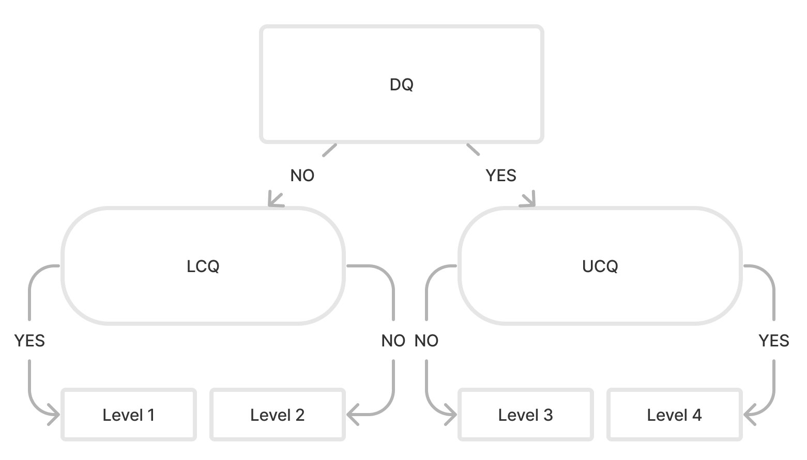
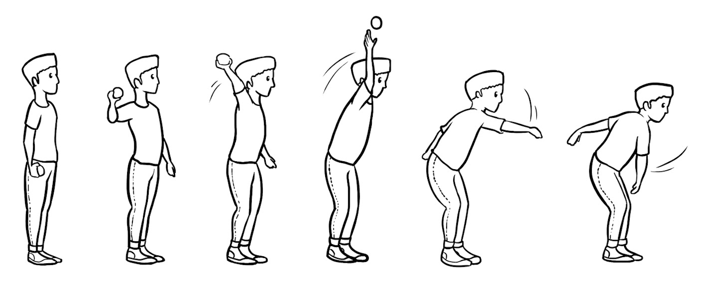
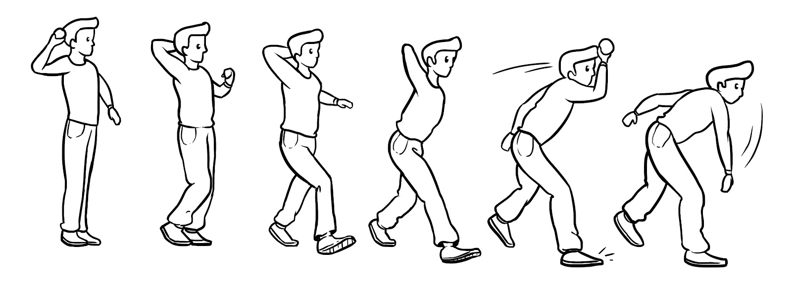
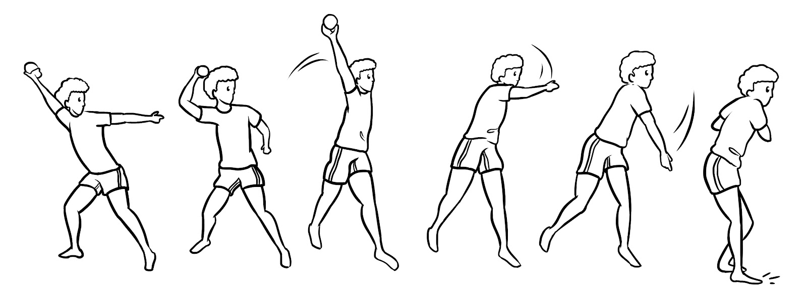
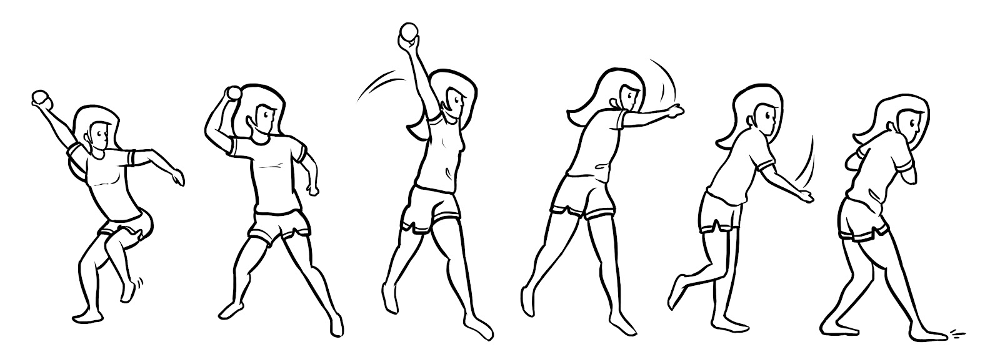

```{=html}
<!-- ============ HERO ============ -->
<section class="fg-hero column-screen" aria-labelledby="hero-title">
  <div class="fg-wrap fg-hero-grid">
    <div class="fg-hero-copy">
      <p class="fg-eyebrow">Avaliação de habilidades motoras · 5 a 10 anos</p>
      <h1 id="hero-title">Veja como uma criança se movimenta com duas perguntas de sim ou não por habilidade.</h1>
      <p class="fg-lead">
        O <strong>FG-COMPASS</strong> ajuda professores, treinadores, profissionais da saúde e pesquisadores a avaliar como as crianças executam
        10 habilidades motoras do dia a dia, como arremessar, chutar e saltar, em uma escala simples de <strong>1 a 4</strong>.
        A observação é feita ao vivo, sem vídeo e sem longas listas de critérios.
      </p>
      <div class="fg-cta">
        <a class="btn btn-primary btn-lg" href="../static/files/fgcompass-decision-trees-v2.2.pdf">
          <i class="bi bi-download" aria-hidden="true"></i> Baixar as árvores de decisão
        </a>
        <a class="btn btn-outline-secondary btn-lg" href="https://drfurtado.github.io/compass-manual/">
          <i class="bi bi-book" aria-hidden="true"></i> Ler o manual
        </a>
      </div>
      <p class="fg-hero-note">PDF gratuito · Validado por pesquisas · Para escolas, clínicas e laboratórios</p>
    </div>

    <!-- Interactive demo -->
    <div class="fg-demo" id="fg-demo" aria-live="polite">
      <div class="fg-demo-head">
        <span class="fg-demo-tag">Experimente</span>
        <span class="fg-demo-skill"><i class="bi bi-dribbble" aria-hidden="true"></i> Arremesso por cima do ombro</span>
      </div>
      <p class="fg-demo-step" id="fg-demo-step">Pergunta 1 de 2</p>
      <p class="fg-demo-q" id="fg-demo-q">O tronco girou para o lado do arremesso durante a preparação?</p>
      <div class="fg-demo-btns" id="fg-demo-btns">
        <button type="button" class="btn fg-yes" data-a="yes">Sim</button>
        <button type="button" class="btn fg-no" data-a="no">Não</button>
      </div>
      <div class="fg-demo-result" id="fg-demo-result" hidden>
        <div class="fg-level-badge" id="fg-demo-level">4</div>
        <div>
          <p class="fg-demo-level-name" id="fg-demo-level-name">Nível 4 · Proficiente</p>
          <p class="fg-demo-level-desc" id="fg-demo-level-desc"></p>
        </div>
      </div>
      <div class="fg-demo-foot">
        <div class="fg-demo-track" aria-hidden="true">
          <span data-l="1">1</span><span data-l="2">2</span><span data-l="3">3</span><span data-l="4">4</span>
        </div>
        <button type="button" class="fg-demo-reset" id="fg-demo-reset" hidden>
          <i class="bi bi-arrow-counterclockwise" aria-hidden="true"></i> Tentar de novo
        </button>
      </div>
    </div>
  </div>
</section>

<!-- ============ AT A GLANCE ============ -->
<section class="fg-stats column-screen" aria-label="FG-COMPASS em resumo">
  <div class="fg-wrap fg-stats-grid">
    <div><strong>10</strong><span>habilidades motoras</span></div>
    <div><strong>2</strong><span>subtestes: locomoção e controle de objetos</span></div>
    <div><strong>5–10</strong><span>anos de idade</span></div>
    <div><strong>4</strong><span>níveis de proficiência</span></div>
    <div><strong>Ao vivo</strong><span>observação direta, sem vídeo</span></div>
  </div>
</section>

<!-- ============ WHY ============ -->
<section class="fg-section column-screen" id="why" aria-labelledby="why-title">
  <div class="fg-wrap fg-two">
    <div>
      <p class="fg-kicker">Por que isso importa</p>
      <h2 id="why-title">As habilidades motoras são a base de uma infância ativa e saudável.</h2>
    </div>
    <div class="fg-prose">
      <p>
        Correr, saltar, arremessar e receber são <em>habilidades motoras fundamentais</em>. Crianças que se movimentam bem
        tendem a ser mais ativas fisicamente, e as pesquisas associam essas habilidades a uma composição corporal mais saudável,
        a funções cognitivas como a memória de trabalho e a mais confiança ao brincar com os colegas.
      </p>
      <p>
        Saber em que ponto a criança está, e onde ela tem dificuldade, permite ensinar o próximo passo e identificar atrasos cedo.
        O FG-COMPASS torna essa verificação rápida o suficiente para caber em uma aula ou sessão clínica comum.
      </p>
    </div>
  </div>
</section>

<!-- ============ HOW IT WORKS ============ -->
<section class="fg-section fg-alt column-screen" id="how-it-works" aria-labelledby="how-title">
  <div class="fg-wrap">
    <p class="fg-kicker">Como funciona</p>
    <h2 id="how-title">Observe, responda, classifique. Só isso.</h2>
    <ol class="fg-steps">
      <li>
        <span class="fg-step-icon"><i class="bi bi-eye" aria-hidden="true"></i></span>
        <h3>Observe a criança executar a habilidade</h3>
        <p>Observe ao vivo, na quadra, no pátio ou na clínica. Um protocolo curto descreve a montagem, as instruções e as tentativas de cada habilidade.</p>
      </li>
      <li>
        <span class="fg-step-icon"><i class="bi bi-signpost-split" aria-hidden="true"></i></span>
        <h3>Responda duas perguntas de sim ou não</h3>
        <p>A primeira pergunta indica os níveis mais baixos ou mais altos. A segunda confirma em qual nível a criança está.</p>
      </li>
      <li>
        <span class="fg-step-icon"><i class="bi bi-bar-chart-steps" aria-hidden="true"></i></span>
        <h3>Obtenha um nível de 1 a 4</h3>
        <p>Registre o nível de cada habilidade para ver o perfil da criança, acompanhar o progresso ou comparar antes e depois de um programa.</p>
      </li>
    </ol>

    <div class="fg-tree" id="fg-tree" data-cap4="Característica-chave presente, padrão proficiente confirmado: <strong>Nível 4, Proficiente</strong>" data-cap3="Característica-chave presente, padrão proficiente não confirmado: <strong>Nível 3, Em desenvolvimento</strong>" data-cap2="Característica-chave ausente, padrão inicial não confirmado: <strong>Nível 2, Emergente</strong>" data-cap1="Característica-chave ausente, padrão inicial confirmado: <strong>Nível 1, Inicial</strong>" data-pause="Pausar" data-play="Reproduzir">
      <div class="fg-tree-head">
        <h3>A árvore de decisão em ação</h3>
        <p>Todas as habilidades usam a mesma árvore de três perguntas. Cada criança segue um único caminho: uma pergunta-chave e depois uma pergunta de confirmação.</p>
      </div>
      <svg viewBox="0 0 560 330" role="img" aria-label="Árvore de decisão animada mostrando os quatro caminhos possíveis até os níveis 1 a 4">
        <g class="e" id="e-q1-l"><path d="M280 76 L130 132"/><text x="185" y="98" class="el">Não</text></g>
        <g class="e" id="e-q1-r"><path d="M280 76 L430 132"/><text x="375" y="98" class="el">Sim</text></g>
        <g class="e" id="e-l-1"><path d="M90 200 L65 252"/><text x="58" y="230" class="el">Sim</text></g>
        <g class="e" id="e-l-2"><path d="M170 200 L195 252"/><text x="202" y="230" class="el">Não</text></g>
        <g class="e" id="e-r-3"><path d="M390 200 L365 252"/><text x="358" y="230" class="el">Não</text></g>
        <g class="e" id="e-r-4"><path d="M470 200 L495 252"/><text x="502" y="230" class="el">Sim</text></g>
        <g class="n" id="n-q1"><rect x="150" y="8" width="260" height="68" rx="14"/><text x="280" y="32" class="k">Pergunta 1</text><text x="280" y="57">Característica-chave?</text></g>
        <g class="n" id="n-l"><rect x="20" y="132" width="220" height="68" rx="34"/><text x="130" y="150" class="k">Pergunta 2</text><text x="130" y="169">Padrão inicial</text><text x="130" y="192">confirmado?</text></g>
        <g class="n" id="n-r"><rect x="320" y="132" width="220" height="68" rx="34"/><text x="430" y="150" class="k">Pergunta 2</text><text x="430" y="169">Padrão proficiente</text><text x="430" y="192">confirmado?</text></g>
        <g class="n lv" id="n-1"><rect x="10" y="252" width="115" height="66" rx="12"/><text x="67" y="281" class="big">Nível 1</text><text x="67" y="303" class="s">Inicial</text></g>
        <g class="n lv" id="n-2"><rect x="140" y="252" width="115" height="66" rx="12"/><text x="197" y="281" class="big">Nível 2</text><text x="197" y="303" class="s">Emergente</text></g>
        <g class="n lv" id="n-3"><rect x="305" y="252" width="115" height="66" rx="12"/><text x="362" y="281" class="big">Nível 3</text><text x="362" y="303" class="s">Em desenvolvimento</text></g>
        <g class="n lv" id="n-4"><rect x="435" y="252" width="115" height="66" rx="12"/><text x="492" y="281" class="big">Nível 4</text><text x="492" y="303" class="s">Proficiente</text></g>
      </svg>
      <div class="fg-tree-foot">
        <p class="fg-tree-cap" id="fg-tree-cap" aria-live="polite">&nbsp;</p>
        <button type="button" class="fg-tree-toggle" id="fg-tree-toggle"><i class="bi bi-pause-fill" aria-hidden="true"></i> <span>Pausar</span></button>
      </div>
    </div>

    <details class="fg-details">
      <summary><i class="bi bi-mortarboard" aria-hidden="true"></i> Para pesquisadores: o modelo de árvore de decisão composta</summary>
      <div class="fg-details-body">
        <div class="fg-prose">
          <p>
            O FG-COMPASS é um instrumento orientado ao processo e referenciado a critério. Cada habilidade é avaliada com uma
            <strong>árvore de decisão composta</strong>, que combina as abordagens do Plano Observacional e dos Três Estágios
            para a avaliação de HMF, usando apenas três critérios-chave de desempenho extraídos de sequências de desenvolvimento validadas e hipotetizadas.
          </p>
          <ul>
            <li><strong>Pergunta discriminatória (DQ)</strong> separa os extremos (níveis 1 e 4).</li>
            <li><strong>Pergunta confirmatória superior (UCQ)</strong> confirma o nível 4; se não confirmar, a criança está no nível 3.</li>
            <li><strong>Pergunta confirmatória inferior (LCQ)</strong> confirma o nível 1; se não confirmar, a criança está no nível 2.</li>
          </ul>
        </div>
        <div class="fg-figure">
          
          <p class="fg-figcap">Modelo comum às dez árvores de decisão (rótulos em inglês).</p>
        </div>
      </div>
    </details>
  </div>
</section>

<!-- ============ SKILLS ============ -->
<section class="fg-section column-screen" id="skills" aria-labelledby="skills-title">
  <div class="fg-wrap">
    <p class="fg-kicker">O que avalia</p>
    <h2 id="skills-title">Dez habilidades, dois subtestes.</h2>
    <div class="fg-skills">
      <div class="fg-skill-card">
        <h3><i class="bi bi-person-walking" aria-hidden="true"></i> Locomoção</h3>
        <p>Deslocar o corpo de um lugar para outro.</p>
        <ul class="fg-chips">
          <li>Saltitar</li><li>Saltar em um pé</li><li>Salto horizontal</li><li>Salto vertical</li><li>Galope</li>
        </ul>
      </div>
      <div class="fg-skill-card">
        <h3><i class="bi bi-dribbble" aria-hidden="true"></i> Controle de objetos</h3>
        <p>Lançar, receber e controlar uma bola.</p>
        <ul class="fg-chips">
          <li>Arremessar</li><li>Receber</li><li>Chutar</li><li>Rebater</li><li>Quicar a bola parado</li>
        </ul>
      </div>
    </div>
  </div>
</section>

<!-- ============ LEVELS ============ -->
<section class="fg-section fg-alt column-screen" id="levels" aria-labelledby="levels-title">
  <div class="fg-wrap">
    <p class="fg-kicker">Como ler os resultados</p>
    <h2 id="levels-title">O que significam os quatro níveis</h2>
    <p class="fg-sub">Exemplo: o arremesso por cima do ombro, das primeiras tentativas ao padrão proficiente.</p>
    <div class="fg-levels">
      <figure class="fg-level">
        
        <figcaption><span class="fg-level-num">1</span><strong>Inicial</strong> A característica-chave proficiente está ausente e o padrão inicial é confirmado.<em>Arremesso: o tronco fica de frente para o alvo e não há passo à frente.</em></figcaption>
      </figure>
      <figure class="fg-level">
        
        <figcaption><span class="fg-level-num">2</span><strong>Emergente</strong> A característica-chave ainda está ausente, mas a criança já superou o padrão inicial.<em>Arremesso: pouca ou nenhuma rotação do tronco, mas a criança dá um passo à frente.</em></figcaption>
      </figure>
      <figure class="fg-level">
        
        <figcaption><span class="fg-level-num">3</span><strong>Em desenvolvimento</strong> A característica-chave está presente, mas o padrão proficiente ainda não está completo.<em>Arremesso: o tronco gira, com um passo curto com o pé oposto.</em></figcaption>
      </figure>
      <figure class="fg-level">
        
        <figcaption><span class="fg-level-num">4</span><strong>Proficiente</strong> A característica-chave está presente e o padrão proficiente é confirmado.<em>Arremesso: o tronco gira, com um passo longo com o pé oposto (pelo menos metade da altura da criança).</em></figcaption>
      </figure>
    </div>
  </div>
</section>

<!-- ============ WHO ============ -->
<section class="fg-section column-screen" id="who" aria-labelledby="who-title">
  <div class="fg-wrap">
    <p class="fg-kicker">Para quem é</p>
    <h2 id="who-title">Prático para a quadra, rigoroso para o laboratório.</h2>
    <div class="fg-cards">
      <article class="fg-card">
        <i class="bi bi-people" aria-hidden="true"></i>
        <h3>Professores de Educação Física e treinadores</h3>
        <p>Avalie uma turma inteira rapidamente, acompanhe o progresso ao longo do ano e veja se um programa está funcionando.</p>
      </article>
      <article class="fg-card">
        <i class="bi bi-heart-pulse" aria-hidden="true"></i>
        <h3>Profissionais da saúde e terapeutas</h3>
        <p>Identifique atrasos motores cedo e planeje intervenções, com níveis claros para compartilhar com as famílias.</p>
      </article>
      <article class="fg-card">
        <i class="bi bi-clipboard-data" aria-hidden="true"></i>
        <h3>Pesquisadores e estudantes</h3>
        <p>Um instrumento orientado ao processo e referenciado a critério, com fidedignidade e concordância com avaliadores especialistas publicadas.</p>
      </article>
    </div>
  </div>
</section>

<!-- ============ EVIDENCE ============ -->
<section class="fg-section fg-alt column-screen" id="evidence" aria-labelledby="evidence-title">
  <div class="fg-wrap fg-two">
    <div>
      <p class="fg-kicker">As evidências</p>
      <h2 id="evidence-title">Mais de 15 anos de pesquisa.</h2>
      <p class="fg-prose">
        O FG-COMPASS foi desenvolvido na Universidade de Pittsburgh e teve sua fidedignidade e concordância com avaliadores especialistas
        testadas em estudos revisados por pares.
      </p>
      <a class="fg-link" href="publications.qmd">Ver todas as publicações <i class="bi bi-arrow-right" aria-hidden="true"></i></a>
    </div>
    <ul class="fg-papers">
      <li>
        <span class="fg-paper-year">2024</span>
        <a href="https://doi.org/10.1177/00315125241272720">Expert-rater agreement and inter/intra-rater reliability of two locomotor skills</a>
        <span class="fg-paper-src">Perceptual and Motor Skills</span>
      </li>
      <li>
        <span class="fg-paper-year">2018</span>
        <a href="https://doi.org/10.1177/0031512518769205">Expert-rater agreement and inter-/intrarater reliability for FG-COMPASS</a>
        <span class="fg-paper-src">Perceptual and Motor Skills</span>
      </li>
      <li>
        <span class="fg-paper-year">2012</span>
        <a href="https://doi.org/10.1080/02701367.2012.10599872">The reliability of classification decisions for FG-COMPASS</a>
        <span class="fg-paper-src">Research Quarterly for Exercise and Sport</span>
      </li>
      <li>
        <span class="fg-paper-year">2009</span>
        <a href="https://d-scholarship.pitt.edu/8917/">Development and initial validation of FG-COMPASS</a>
        <span class="fg-paper-src">Tese de doutorado, Universidade de Pittsburgh</span>
      </li>
    </ul>
  </div>
</section>

<!-- ============ GET STARTED ============ -->
<section class="fg-section fg-final column-screen" id="get-started" aria-labelledby="start-title">
  <div class="fg-wrap">
    <h2 id="start-title">Comece agora</h2>
    <div class="fg-start">
      <a class="fg-start-card" href="download.qmd">
        <i class="bi bi-file-earmark-arrow-down" aria-hidden="true"></i>
        <strong>Árvores de decisão</strong>
        <span>As 10 árvores de avaliação em PDF. Versão em português em breve.</span>
      </a>
      <a class="fg-start-card" href="https://drfurtado.github.io/compass-manual/">
        <i class="bi bi-book" aria-hidden="true"></i>
        <strong>Manual do usuário</strong>
        <span>Protocolos de teste, pontuação e interpretação (em inglês).</span>
      </a>
      <a class="fg-start-card" href="../assess/index.html">
        <i class="bi bi-phone" aria-hidden="true"></i>
        <strong>Aplicativo web <em>beta</em></strong>
        <span>Avalie as 10 habilidades no celular ou computador (em inglês por enquanto).</span>
      </a>
    </div>
    <p class="fg-name-note">
      FG-COMPASS é a sigla, em inglês, de Furtado–Gallagher Children Observational Movement Pattern Assessment System
      (Sistema Furtado–Gallagher de Avaliação Observacional de Padrões de Movimento em Crianças). Antes chamado
      Furtado–Gallagher <em>Computerized</em> Observational Movement Pattern Assessment System.
    </p>
  </div>
</section>

<script>
window.FG_DEMO = {
  q1:  { step: "Pergunta 1 de 2", q: "O tronco girou para o lado do arremesso durante a preparação?", yes: "up", no: "low" },
  up:  { step: "Pergunta 2 de 2", q: "Houve um passo longo com a perna oposta ao braço de arremesso?", yes: 4, no: 3 },
  low: { step: "Pergunta 2 de 2", q: "A criança deixou de dar um passo à frente?", yes: 1, no: 2 },
  result: "Resultado", level: "Nível",
  levels: {
    1: ["Inicial",            "A característica-chave proficiente está ausente e o padrão inicial é confirmado."],
    2: ["Emergente",          "A característica-chave ainda está ausente, mas a criança já superou o padrão inicial."],
    3: ["Em desenvolvimento", "A característica-chave está presente, mas o padrão proficiente ainda não está completo."],
    4: ["Proficiente",        "A característica-chave está presente e o padrão proficiente é confirmado."]
  }
};
</script>
<script src="../fg-demo.js"></script>
<script src="../fg-tree.js"></script>
```
